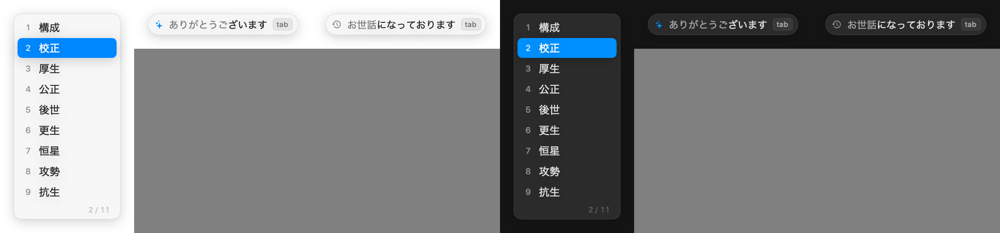

# Tsumugi

ローカル LLM を内蔵した、自作の日本語入力メソッド (macOS)。

- **ライブ変換** — 打ったそばから漢字になる。変換コア (ラティス + Viterbi) は自作、辞書データは Mozc OSS。
- **LLM が文脈で見直す** — 超小型モデル zenz (74MB) が左文脈を読んで同音異義語を選ぶ。1 回 10〜30ms、すべて端末内。
- **Tab で先読みを確定** — 履歴と LLM から、続きが言い切れるときだけ小さく提案する。
- **使うほど賢くなる** — 選び直した変換、確定した句、句のつながりを学習する。止められて、消せる。



設計の考え方と実測値は [docs/DESIGN.md](docs/DESIGN.md)。

> **いまの状態**: 個人開発の試作段階です。署名済みのインストーラはまだ配布していないため、ソースからビルドして使います。
> Apple Silicon の Mac (M1 以降) で動作を確認しています。

## プライバシー

- 変換・予測・学習はすべて Mac の中で行います。入力内容をネットワークに送る処理はありません。
- 学習内容は `~/Library/Application Support/Tsumugi/user_model.json` (本人のみ読み書き可) の 1 ファイルだけです。
- 入力メニューから学習の一時停止と全消去ができます。パスワード欄では macOS の仕様で Tsumugi は呼ばれません。

## インストール (ソースから)

必要なもの: macOS 13 以降、Xcode (Swift 5.9 以降)、cmake (`brew install cmake`)、python3。
ダウンロードとビルドで 10 分ほどかかり、約 1.5GB の空きが要ります。

```sh
git clone https://github.com/Anieca/tsumugi.git
cd tsumugi
make data      # Mozc 辞書 (約 97MB) と zenz モデル (約 74MB) をダウンロード
make llama     # llama.cpp を取得してビルド (zenz 用の小さなパッチを当てる)
make test      # テスト
make install   # build/Tsumugi.app を作り ~/Library/Input Methods に入れて登録
```

インストール後、**システム設定 > キーボード > 入力ソース > 編集… > ＋ > 日本語** から Tsumugi を追加する。
一覧に出ないときは一度ログアウトしてログインし直す。
メニューバーの入力メニューが開かなくなったときは `killall TextInputMenuAgent` で macOS 側のメニューを再起動する。

更新は `git pull && make install`、削除は `rm -rf ~/Library/Input Methods/Tsumugi.app` のあと入力ソースから外す。

登録せずに試すだけなら:

```sh
make playground
```

## 使い方

| キー | はたらき |
|---|---|
| 文字 | ローマ字入力。打つそばから変換される |
| Tab | 先読みを確定 |
| Space | 候補を開く / 次の候補 |
| ← → / Shift+← → | 文節の移動 / 伸縮 |
| Enter / Esc | 確定 / 取り消し |
| F6・F7・F10 (Ctrl+J・K・L) | ひらがな・カタカナ・英数 |

入力メニュー (メニューバーの「紡」) から、先読みの切り替え、学習の一時停止、学習内容の消去ができる。
学習は自動で、候補を選び直して確定した変換、確定した言い回し、続けて打つ句のつながりを覚える。

## 開発用 CLI

```sh
.build/release/tsumugi-cli convert きょうはいいてんきですね      # 辞書だけで変換
.build/release/tsumugi-cli llm こうせいをかくにんする "原稿の誤字を直したので、"  # LLM + 検証
.build/release/tsumugi-cli predict ありがとうご                  # 続きの予測と確率
.build/release/tsumugi-cli type kyouha "<space>" "<enter>"       # 打鍵を流す
```

## 構成

| 場所 | 中身 |
|---|---|
| `Sources/TsumugiCore` | ローマ字、辞書、変換、学習、入力セッション (UI 非依存) |
| `Sources/TsumugiLLM` | llama.cpp で zenz を動かす |
| `Sources/TsumugiUI` | 候補リストと先読みピル、キー対応 |
| `Sources/TsumugiIME` | InputMethodKit の入力メソッド本体 |
| `Sources/TsumugiPlayground` | 登録なしで試せるウインドウ |
| `Tools/build_dict.py` | Mozc 辞書 → バイナリ辞書 |

## ライセンス

Tsumugi のソースコードは [MIT License](LICENSE)。

ビルド時にダウンロードして同梱する辞書・モデル・推論ライブラリは、それぞれのライセンスに従います (辞書は BSD 3-Clause、zenz モデルは CC BY-SA 4.0、llama.cpp は MIT)。
詳細は [NOTICE.md](NOTICE.md)。ビルドした Tsumugi.app を再配布するときは、これらの表示を必ず含めてください。

変換モデル [zenz](https://huggingface.co/Miwa-Keita/zenz-v3.2-small-gguf) (Keita Miwa) と [Mozc](https://github.com/google/mozc) に感謝します。
